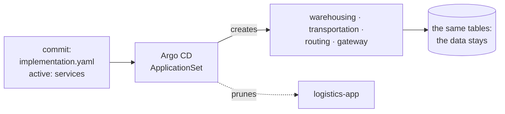
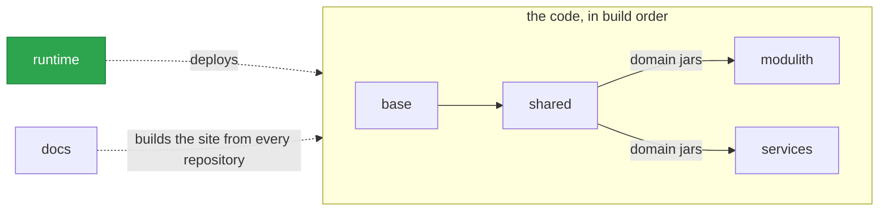

# FF Logistic: runtime

**What FF Logistic runs but does not write: the cluster, Argo CD, the platform, and the switch between the two implementations.**

Part of **[FF Logistic](https://github.com/ffetih/ff-logistic-docs)**: one logistics product built twice, as a modular monolith and as microservices, on the same Kubernetes platform, behind one switch. The business rules are written once; only the wiring differs. Start at the hub for the whole picture.

## What's here

| Path | What |
| :--- | :--- |
| `deploy/cluster` | The k3d cluster (one node, WSL) |
| `deploy/argocd` | Argo CD 3.6, managing its own install, and `ff-root`, the app of apps |
| `deploy/platform` | PostgreSQL 17, Keycloak, Kafka 4.2 (KRaft), RustFS (S3), Argo Rollouts, and the edge: the one entry point on `:8081` |
| `deploy/charts/ff-service` | The Helm chart every application runs with: a canary Rollout with analysis, PreSync migration and PostSync smoke-test Jobs |
| `deploy/implementation.yaml` | **The switch**: `active: modulith` or `active: services`. An ApplicationSet deploys the side it names, and prunes the other |
| `.github/workflows` | The reusable CI every repository calls: build, test, publish the images to GHCR, commit the new tags |

## Run it

Everything is applied from Git by Argo CD, except the cluster and Argo CD itself. Start with the [Cluster Guide](https://ffetih.github.io/ff-logistic-docs/runtime/cluster-guide.html).

## Where it fits

Six repositories: base, then shared, then modulith and services are built in that order; runtime deploys them; docs builds the documentation site from all six. This one is green.

## Read more

- This repository's page on the documentation site: [Runtime](https://ffetih.github.io/ff-logistic-docs/runtime/index.html)
- The hub, with the architecture, the decisions and the plan: [ff-logistic-docs](https://github.com/ffetih/ff-logistic-docs)
- Every page, in one site: [ffetih.github.io/ff-logistic-docs](https://ffetih.github.io/ff-logistic-docs/)
